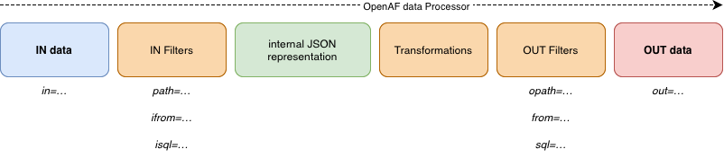

# oafp

OpenAF processor (oafp) is a command-line utility, distributed with OpenAF (since version 20240318), that takes an input, usually a data structure such as json, and transforms it to an equivalent data structure in another format or visualization. The output data can be filtered through JMESPath, SQL or OpenAF's nLinq and provided transformers can also be applied to it.

The tool comes with it's own built-in documentation that can be accessed by executing:

```bash
oafp -h
```

or you can check it here:

| Document |
|----------|
| [oafp usage documentation](../guides/oafp/oafp-usage.md) |
| [oafp filters documentation](../guides/oafp/oafp-filters.md) |
| [oafp templates documentation](../guides/oafp/oafp-template.md) |
| [oafp basic examples](../guides/oafp/oafp-basic-examples.md) |

If you have internet access you can also access a library of examples:

```bash
oafp -examples
oafp examples=unix::
oafp examples=kubernetes::kubectl
oafp examples=env
```

You can also check the library of examples in [oafp examples](../guides/oafp/oafp-examples.md).

If you don't find a suitable example you can also use [OAFP ChatGPT](https://chatgpt.com/g/g-uBUaPluLw-oafp).

---

## Concepts



_oafp_ reads input data format, filters that data into an internal JSON representation. Then the internal JSON representation can be transformed and filtered again to an output data format.

### 📌 oafp Filters: path, from, sql and their order

The oafp tool is powerful, but the way filters are applied can trip people up. Here’s a breakdown to help clarify.

#### 🔁 Order of Processing in oafp

Standard flow:

```
input → path → transformers → from → sql → output
```

Advanced flow:

```
input → ifrom → isql → path → transformers → from → sql → opath → output
```

#### 🔹 Filter Types Explained

| Filter | Purpose | Example |
|--------|---------|---------|
| *path* | A JMESPath expression applied to raw input | ```path="[].data"``` |
| *from* | Applies $from() operations after path | ```from="sort(date)"``` |
| *sql* | SQL-like query applied to $from() result | ```sql="select * where size > 1000"``` |
| *opath* | JMESPath applied to the final result | ```opath="[].name"``` |
| *ifrom* | $from() logic before path | ```ifrom="sort(name)"``` |
| *isql* | SQL logic before path (less common) | ```isql="select name from input"``` |

#### 🧠 Key Takeaways

* Use path to shape the raw input.
* Use from for logic using OpenAF’s $from() like sort, group, distinct, etc.
* Use sql when it’s easier to express logic in SQL.
* Use opath for a final transformation before output.

#### ✅ Recommended Pattern

Start with path to normalize the data → then use from or sql depending on preference → finally apply opath if you need to tweak output.

---

You can check more examples of usage in the [oafp guides](../guides/oafp/).

## October processing features

See [decisions and interactive JSON exploration](../guides/oafp/october-features.md) for `in=llmdecide`, per-entry decision enrichment, and `out=idesc` with loaded or file-backed JSON. The [processor reference](../guides/oafp/oafp-reference.md) provides an overview of the wider pipeline.
