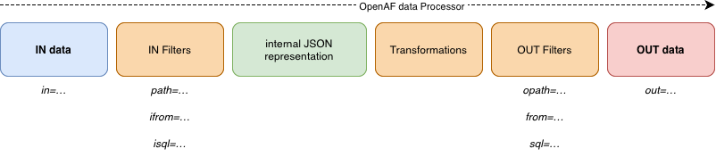

# oafp

OpenAF processor (oafp) is a command-line utility, distributed with OpenAF (since version 20240318), that takes an input, usually a data structure such as json, and transforms it to an equivalent data structure in another format or visualization. The output data can be filtered through JMESPath, jq, SQL or OpenAF's nLinq and provided transformers can also be applied to it.

The tool comes with its own built-in documentation that can be accessed by executing:

```bash
oafp -h
```

or you can check it here:

| Document |
|----------|
| [oafp usage documentation](../guides/oafp/oafp-usage.md) |
| [oafp filters documentation](../guides/oafp/oafp-filters.md) |
| [oafp templates documentation](../guides/oafp/oafp-template.md) |
| [oafp basic examples](../guides/oafp/oafp-basic-examples.md) |

If you have internet access you can also access a library of examples:

```bash
oafp -examples
oafp examples=unix::
oafp examples=kubernetes::kubectl
oafp examples=env
```

You can also check the library of examples in [oafp examples](../guides/oafp/oafp-examples.md).

If you don't find a suitable example you can also use [OAFP ChatGPT](https://chatgpt.com/g/g-uBUaPluLw-oafp).

---

## Concepts



_oafp_ reads input data format, filters that data into an internal JSON representation. Then the internal JSON representation can be transformed and filtered again to an output data format.

### Filter order

Every filter is optional, but execution order is fixed independently of command-line argument order:

```text
input → ifrom → isql → path → ijq (alias jq) → transforms → from → sql → opath → ojq → output
```

| Filter | Query engine | Applied to |
| --- | --- | --- |
| `ifrom` / `from` | OpenAF nLinq | Input / transformed output |
| `isql` / `sql` | SQL | Input / transformed output |
| `path` / `opath` | JMESPath plus OpenAF functions | Input / transformed output |
| `ijq` (or `jq`) / `ojq` | JVM jq 1.6 engine | After the corresponding JMESPath stage |

Do not supply both `jq` and `ijq`. A jq expression producing no value suppresses that record; several emissions become one collected array. Streaming behavior and JSON compatibility are described in the [filter reference](../guides/oafp/oafp-filters.md).

```sh
oafp in=json data='[{"name":"Ana","active":true},{"name":"Ben","active":false}]' jq='map(select(.active))' ojq='map(.name)' out=json
# ["Ana"]
```

See the [source baseline](../source-snapshot.md) for the distinction between development oafp, the processor bundled with OpenAF, and the `oafproc` package.

## Decisions and interactive exploration

See [decisions and interactive JSON exploration](../guides/oafp/october-features.md) for `in=llmdecide`, per-entry decision enrichment, and `out=idesc` with loaded or file-backed JSON. The [processor reference](../guides/oafp/oafp-reference.md) provides an overview of the wider pipeline.
